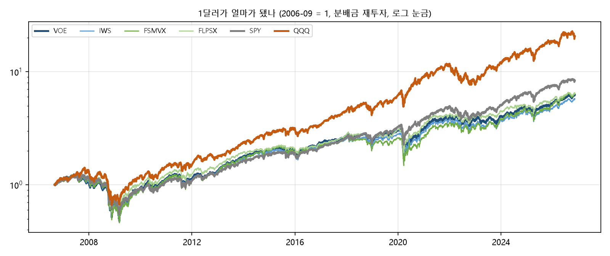
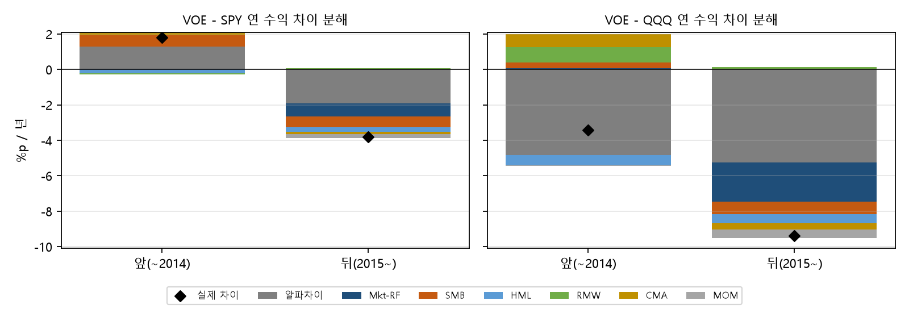
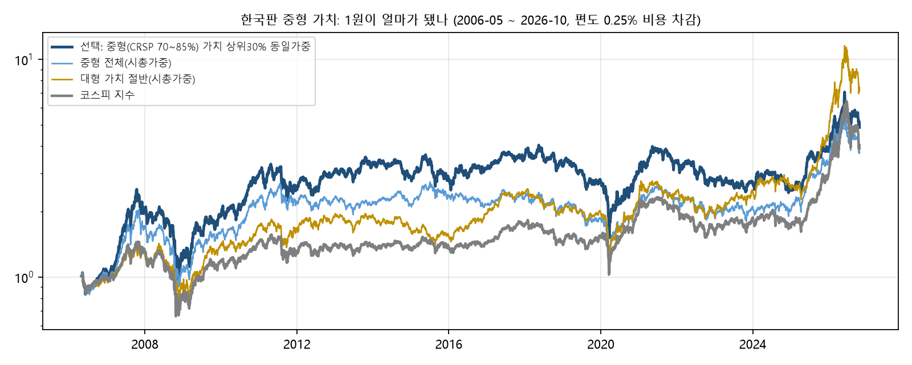

# 중형 가치주 ETF 검증 (래리 윌리엄스 추천)

래리 윌리엄스가 장기 보유용으로 권한 중형 가치주 상품(Vanguard Mid-Cap Value ETF, Fidelity 펀드)이 S&P500·나스닥100보다 나았는지 확인하고, 성과를 가른 특징을 뽑은 뒤, 같은 규칙으로 한국판 중형 가치 지수를 만들어 검증합니다. 포트폴리오용 검증이며 실제 매매 코드는 없습니다.

📄 보고서: [중형가치주_ETF_검증_보고서.pdf](중형가치주_ETF_검증_보고서.pdf) · [docx](중형가치주_ETF_검증_보고서.docx)

## 규칙
- 미국 상품: VOE(CRSP 미국 중형 가치), IWS(러셀 중형 가치), FSMVX·FLPSX(Fidelity 액티브. 래리가 말한 펀드가 어느 것인지 확인되지 않아 둘 다 넣음), IJJ. 비교 대상은 SPY와 QQQ이고, 원인을 나눠 보려고 VO(중형 전체)·IWD(대형 가치)도 넣었습니다.
- 특성 추출: 파마-프렌치 5팩터 + 모멘텀 회귀(Newey-West t값), SPY·QQQ와의 수익 차이를 팩터별로 분해, 중형×가치 2×2 비교
- 구간: 학습 ~2014 / 검증 2015~2019 / 테스트 2020~. 학습 구간에서 고른 조합으로 테스트는 한 번만 했습니다.
- 상대 모멘텀 전환 규칙: 직전 3·6·12개월 수익이 높은 쪽을 다음 달에 보유합니다(IWS vs SPY, IWS vs QQQ, 6개 조합).
- 한국판: 매년 4월 말에 코스피 비금융 종목(상장폐지 포함)에서 고릅니다.
  - 중형 정의 2개: CRSP 방식(누적 시가총액 70~85%), KRX 방식(시가총액 101~300위)
  - 가치 기준 2개: 가치 점수 상위 50%, 상위 30%
  - 비중 2개: 시가총액 가중, 동일가중
  - 가치 점수 2개 판: 장기판(B/P 하나, 2006~), CRSP판(B/P·E/P·S/P, 2014~)
  - 이렇게 만든 16개 조합 중에서 고릅니다. 거래비용은 편도 0.25%입니다.

## 핵심 결과
| 상품 (2006-09~2026-11) | 연수익 | 샤프 | 최대낙폭 |
|---|---|---|---|
| VOE (중형 가치) | 9.5% | 0.46 | -62% |
| IWS (러셀 중형 가치) | 9.1% | 0.44 | -62% |
| FSMVX (Fidelity 중형 가치) | 9.6% | 0.45 | -63% |
| FLPSX (Fidelity 저가주) | 9.7% | 0.52 | -55% |
| SPY | 11.1% | 0.56 | -55% |
| QQQ | 16.2% | 0.72 | -53% |

| 한국판 (학습에서 고른 조합: CRSP 중형·가치 상위 30%·동일가중) | 학습 2006-05~2014 | 검증 2015~2019 | 테스트 2020~2026-10 |
|---|---|---|---|
| 중형 가치 | 13.3% | -1.0% | 8.9% |
| 코스피 | 3.6% | 2.9% | 15.0% |

- 5년 보유 구간 기준으로 VOE가 SPY를 이긴 비율은 36%, QQQ를 이긴 비율은 2%입니다. 2014년까지는 SPY보다 연 1.8%p 앞섰고, 2015년 이후 연 3.8%p 뒤졌습니다. 한국도 같은 시기에 뒤집혔습니다.
- VOE의 특징은 시장 베타 0.96, 소형 0.20, 가치 0.28, 수익성 0.11, 보수적 투자 0.18입니다. 같은 중형주 안에서 가치주와 중형 전체의 차이는 연 -0.2%p(t -0.2)로 거의 0입니다. 격차는 대형 기술주의 '팩터로 설명 안 되는 초과수익'에서 나왔습니다.
- 상대 모멘텀 전환 규칙은 테스트에서 SPY·QQQ 보유보다 못했습니다. 한국판은 중형 경계를 4가지로 바꿔 봐도 모두 학습 구간에서만 좋았습니다.

### 결과를 본 뒤 찾은 신호: 10년 금리가 3개월 오르면 다음 달 가치주가 유리
| 2001~2026 다음 달 | 연 차이 | t |
|---|---|---|
| IWS − SPY | +6.7%p | 2.7 |
| IWS − QQQ | +16.7%p | 3.3 |
| IWD − SPY (대형 가치) | +4.8%p | 2.5 |

- 5년 블록 5개 모두 같은 방향입니다. 1963~2000에서는 나타나지 않았는데, 그때는 금리가 오르면 주가가 빠지던 시장이었습니다(주가-금리 상관이 플러스인 달이 2%, 2001년 이후는 84%). 그래서 옛 자료로는 판정할 수 없습니다.
- 원인으로 의심한 설명 네 가지(듀레이션, 성장주 되돌림, 리밸런싱, 가치주로의 순환매)는 검정에서 모두 기각됐습니다. 남는 사실은 "금리 상승의 타격이 기술주에 한 달 늦게 온다"는 것입니다(다음 달 QQQ 연 22.3% → 8.6%, t -1.7). 가치 ETF로 거래가 몰리는 흔적은 없었습니다.
- 매달 통째로 갈아타면 2015~2019 알파 t가 -1.6이었습니다. 그래서 가치·성장 비중을 조금 기울이는 보조 신호로만 봅니다.

## 실행
1. 한국 시세는 MySQL `stock_db`(상장폐지 포함 패널)를 씁니다. 접속 정보는 `.env`에 둡니다. 패널 코드는 `larry_panel.py`(래리 윌리엄스 검증의 데이터 모듈 사본)입니다.
2. 미국 시세는 야후, 팩터는 Ken French 자료, 금리는 FRED에서 받습니다(KRX 요청 없음).
3. `python data.py` → `python run.py` → `python robust.py` → `python regime_check.py` → `python mechanism.py` → `python mechanism2.py` → `python rotation.py` → `python volume_check.py` → `python build_report.py 최종`

## 한계·주의
- 미국 상품은 실제 상품 수익률이라 생존편향이 없지만, VOE 상장(2006) 이후 한 경로뿐입니다. 가치 프리미엄이 약했던 시기와 겹칩니다.
- French 25 포트폴리오를 받지 못해 1963~2000 중형 가치 수익은 팩터 노출로 합성했습니다.
- 한국: 시장 구분은 마지막 상장 시장 기준입니다. B/P 출처는 2006~2025 KRX PBR, 2026 DART 자본으로 섞여 있습니다. 상장폐지 종목은 마지막 가격에서 멈춘 것으로 처리했습니다. 수익률은 배당 제외 가격 기준입니다.
- 금리 신호는 결과를 보고 찾은 것(6개 상태 중 하나)이라 새 데이터로 다시 확인해야 합니다. 거래량은 매수·매도를 구분하지 못합니다. 실제 자금 유입(ETF 설정·환매 이력)은 확인하지 못했습니다.
