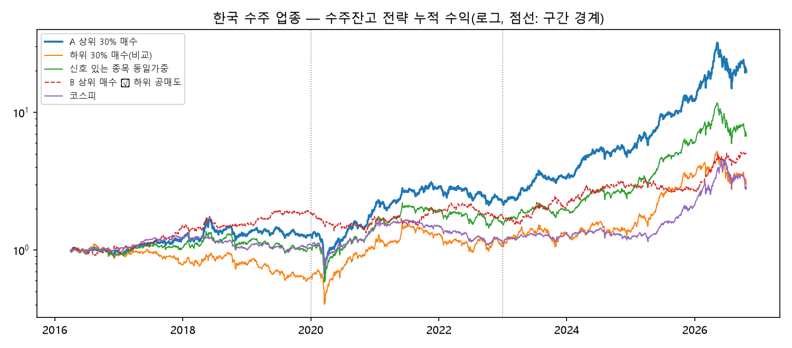
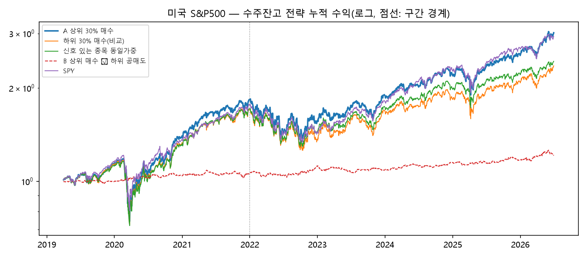

# 수주잔고 전략

받아 둔 일감(수주잔고)이 매출보다 빨리 쌓이는 회사는 앞으로 매출이 빨라지고, 주가가 천천히 따라 오른다는 가설을 검증합니다. 포트폴리오용 검증이며 실제 매매 코드는 없습니다.

📄 보고서: [수주잔고_전략_보고서.pdf](수주잔고_전략_보고서.pdf) · [docx](수주잔고_전략_보고서.docx)

## 규칙
- 신호: 수주잔고 전년 대비 증가율 − 매출 증가율 (분기말에 이미 공시된 값만 사용, 한국 연간 매출은 다음 해 4월부터)
- 수주잔고 출처
  - 한국: DART 정기보고서 원문 '수주상황' 표 (원문 약 4,000건에서 직접 읽음)
  - 미국: SEC XBRL 수주잔고(RPO), 없으면 계약부채
- 유니버스
  - 한국: 코스피 시가총액 상위 200 중 건설·조선·기계·전기전자·IT서비스 (상장폐지 포함)
  - 미국: 그 시점 S&P500 구성종목
- 분기말에 상위 30%를 동일가중으로 사서 2분기 보유 (미국은 업종 안 순위)
- 거래비용 편도: 한국 0.25%, 미국 0.1%

## 핵심 결과 (전체 기간)
| 시장 | 전략 | 연수익 | 샤프 | 최대낙폭 | 알파 t값 |
|---|---|---|---|---|---|
| 한국 2016~ | 상위 30% 매수 | 33.7% | 0.99 | -59.7% | 2.96 |
| 한국 2016~ | 같은 전략, 2025년 제외 | 25.7% | 0.80 | -59.7% | 2.63 |
| 한국 2016~ | 수주 업종 전부(동일가중) | 20.4% | 0.72 | -57.0% | 1.83 |
| 한국 2016~ | 코스피 | 10.5% | 0.45 | -43.9% | - |
| 한국 2016~ | 상위 매수 − 하위 공매도 | 17.2% | 0.83 | -31.8% | 2.66 |
| 미국 2019~ | 상위 30% 매수 | 16.5% | 0.70 | -37.2% | 0.59 |
| 미국 2019~ | SPY | 16.1% | 0.72 | -33.7% | - |
| 미국 2019~ | 상위 매수 − 하위 공매도 | 2.8% | 0.58 | -5.9% | 1.44 |

알파는 한국이 코스피 대비, 미국이 6팩터(파마-프렌치 5요인 + 모멘텀) 기준입니다.

- 한국은 학습(2016~2019)·검증(2020~2022)·테스트(2023~) 세 구간 모두 상위 30%가 업종 평균보다 높았습니다.
- 한국은 상위 비율(20·30·40%) × 보유 기간(1·2·4분기) 9개 조합 모두, 2025년을 넣든 빼든 롱숏 알파 t값이 1.97 이상입니다. 거래비용을 2배로 해도 결과가 거의 같습니다.
- 미국은 신호의 순위 예측력(t 4.1)은 있지만 크기가 작아, 사기만 해서는 SPY와 같았습니다.

## 실행
1. 보조 코드(`../druckenmiller_13f`)로 데이터를 수집합니다: `fetch_extra.py us` (SEC), `kr_orders.py fetch` (DART 원문, `DART_API_KEY` 필요)
2. `python data.py` → `python run.py` → `python build_report.py 최종`

## 한계·주의
- 한국은 상위 30%가 평균 7.5종목이라 집중도가 높고, 최대낙폭이 -60%입니다.
- 한국 2020~2022 구간에서는 롱숏 효과가 0에 가까웠습니다.
- 한국 수주잔고는 원문 표를 규칙으로 읽은 값이라 잡음이 있습니다.
- 한국 수주 업종 전체가 2020년 이후 강했으므로, 업종 평균 대비 성과로 봐야 합니다.
- 생존편향: 한국은 상장폐지 종목을 포함했습니다. 미국은 과거 S&P500 구성종목을 포함했지만 일부 상장폐지 종목 시세가 빠졌습니다.
- 미국은 수주잔고 공시가 2019년부터라 기간이 짧습니다.
- PARA는 시세 오류로 제외했습니다.
- 이 신호는 여러 후보를 시험하다 살아남은 것입니다. 규칙의 숫자(상위 30%, 2분기 보유)는 미리 정했고 고르지 않았습니다.
